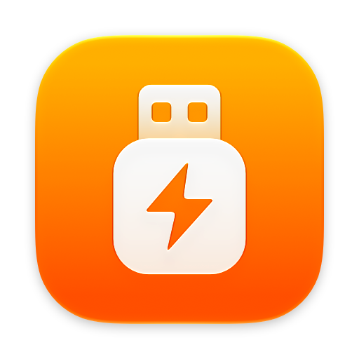
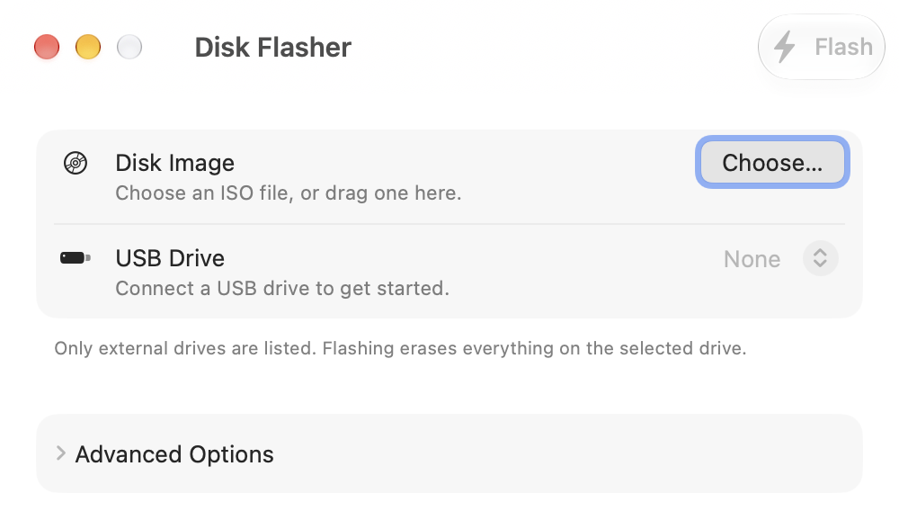
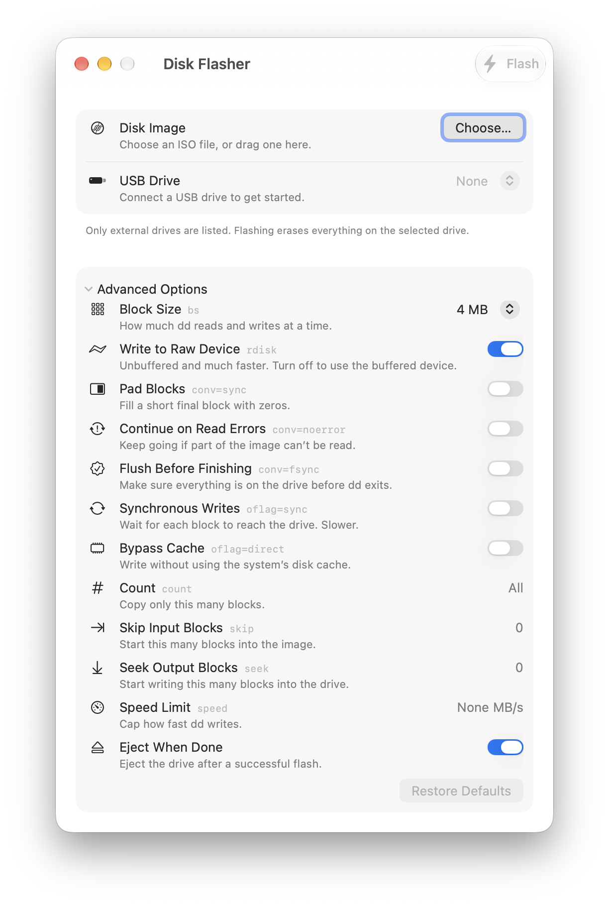

<p align="center">
  
</p>

<h1 align="center">Disk Flasher</h1>

A small, native macOS app for writing ISO and IMG disk images to USB drives. It is a friendly window on top of the `dd` command that ships with every Mac, so there is nothing else to install.

<p align="center">
  
</p>

## What it does

- Pick a disk image with the standard file picker, or drag an `.iso` or `.img` file onto the window.
- Choose the target from a menu of connected drives. Only external drives are listed, so your Mac's internal disk can never be selected.
- Drives appear and disappear in the menu as you plug them in and remove them. There is no need to restart the app.
- Asks for confirmation before erasing anything, and shows the drive's name, size and device path so you can be sure it is the right one.
- Shows progress while flashing, and lets you cancel.
- Ejects the drive when it finishes, so it is safe to unplug.
- Exposes the common `dd` options in an Advanced Options panel for when you need them.

## Requirements

- macOS 15 (Sequoia) or later
- An administrator password, because writing directly to a drive requires it
- A USB drive at least as large as the disk image

## Install

1. Download the latest `DiskFlasher-….zip` from the [Releases page](https://github.com/5achin/DiskFlasher/releases/latest).
2. Unzip it and drag **DiskFlasher** into your Applications folder.
3. Open it.

### The first time you open it

Disk Flasher is not signed with an Apple Developer ID, so macOS blocks it the first time with a message that it could not be verified. To allow it:

1. Try to open the app once, then dismiss the warning.
2. Open **System Settings › Privacy & Security**.
3. Scroll down to the message about DiskFlasher and click **Open Anyway**.
4. Confirm with your password or Touch ID.

You only need to do this once.

## How to use it

> [!WARNING]
> Flashing erases **everything** on the selected drive, and it cannot be undone. Back up anything you want to keep, and double-check which drive is selected before you continue.

1. **Plug in your USB drive.** It shows up in the **USB Drive** menu within a couple of seconds.
2. **Choose the disk image.** Click **Choose…** next to **Disk Image**, or drag the file onto the window.
3. **Check the drive.** If more than one external drive is connected, pick the right one from the **USB Drive** menu. Its connection type and device path (for example `/dev/disk4`) are shown underneath.
4. **Click Flash** in the toolbar, or press Return.
5. **Confirm.** Read the dialog, then click **Erase and Flash**.
6. **Enter your administrator password** when macOS asks for it.
7. **Wait for it to finish.** A progress bar shows how much has been written. Large images can take several minutes.
8. When you see **Flash Complete**, the drive has been ejected and you can unplug it.

To stop partway through, click **Cancel** in the toolbar. A drive that was cancelled mid-flash is left partially written, and is unusable until you flash it again or erase it in Disk Utility.

## Advanced options

Click **Advanced Options** to expand the panel. The defaults suit almost every image, so you can leave these alone unless you know you need one. Each row shows the `dd` operand it controls.

<p align="center">
  
</p>

| Option | `dd` operand | Default | What it does |
| --- | --- | --- | --- |
| Block Size | `bs` | 4 MB | How much is read and written at a time. |
| Write to Raw Device | `/dev/rdiskN` | On | Writes to the unbuffered device, which is much faster. Turn off to use the buffered device. |
| Pad Blocks | `conv=sync` | Off | Fills a short final block with zeros. |
| Continue on Read Errors | `conv=noerror` | Off | Keeps going if part of the image can't be read. |
| Flush Before Finishing | `conv=fsync` | Off | Makes sure everything is on the drive before `dd` exits. |
| Synchronous Writes | `oflag=sync` | Off | Waits for each block to reach the drive. Slower. |
| Bypass Cache | `oflag=direct` | Off | Writes without using the system's disk cache. |
| Count | `count` | All | Copies only this many blocks. |
| Skip Input Blocks | `skip` | 0 | Starts this many blocks into the image. |
| Seek Output Blocks | `seek` | 0 | Starts writing this many blocks into the drive. |
| Speed Limit | `speed` | None | Caps the write speed, in MB/s. |
| Eject When Done | | On | Ejects the drive after a successful flash. |

**Restore Defaults** puts everything back the way it started.

## Troubleshooting

**My drive isn't in the list.**
Only external, writable drives are shown. Try unplugging the drive and plugging it back in, or a different port or cable. If it doesn't appear in Disk Utility either, the Mac isn't seeing it at all.

**macOS says the app can't be opened.**
See [The first time you open it](#the-first-time-you-open-it).

**"The data would not fit."**
The disk image is larger than the drive. Use a bigger drive.

**"…is no longer the drive you selected."**
A drive was unplugged or swapped after you chose it. Pick the drive again from the menu and click Flash once more.

**macOS says the disk is not readable after flashing.**
This is normal for many images, Linux installers in particular, because macOS doesn't understand their format. Click **Eject**, not Initialize. The drive will still boot.

**I cancelled and now the drive doesn't work.**
Flash it again, or erase it in Disk Utility to use it as a normal drive.

## Building from source

You need Xcode 16 or later.

```bash
git clone https://github.com/5achin/DiskFlasher.git
cd DiskFlasher
scripts/build.sh --open
```

The app is written to `build/Release/DiskFlasher.app`. Add `--zip` to also produce `build/Release/DiskFlasher.zip`. You can also open `DiskFlasher.xcodeproj` in Xcode and press Run.

Every push to `main` builds the app with GitHub Actions and publishes it as a new release.

## How it works

Disk Flasher uses only tools that come with macOS:

- `diskutil` to list external drives, unmount the target before writing, and eject it afterwards
- `dd` to write the image
- the standard macOS administrator prompt to get permission to write to the drive

The app is built with SwiftUI.
